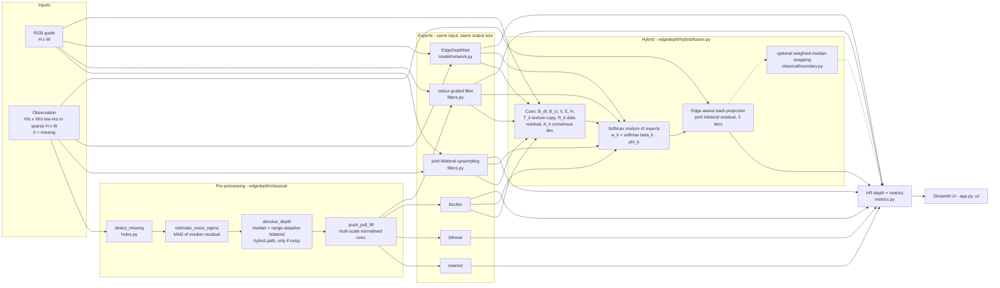
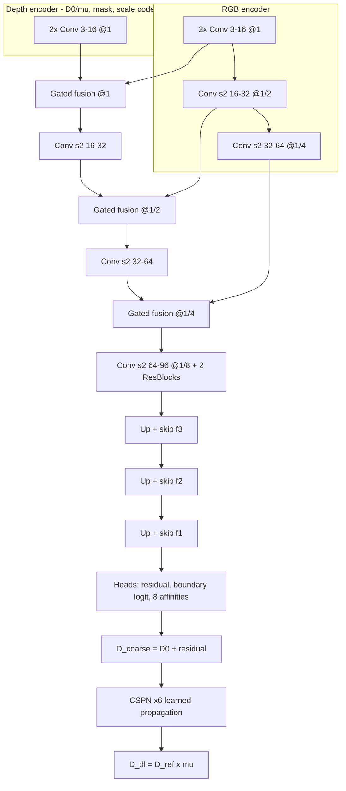
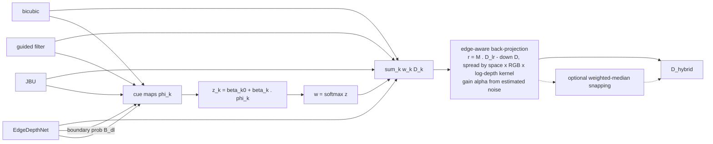

# EdgeDepth — Architecture

This document describes the system as implemented in the repository. File and
function names refer to real code; the Mermaid source of the main diagram is
[`architecture.mmd`](architecture.mmd).

## 1. System architecture

### Code map

| Layer | Path | Responsibility |
|---|---|---|
| I/O | `edgedepth/io_utils.py` | decode RGB / depth (16-bit PNG, 8-bit PNG, `.npy`), validation, fixed-range colour maps |
| Degradation | `edgedepth/degradation.py` | `Observation` object, box-downsampling, sparse sampling, Kinect noise, random / blob / edge holes |
| Classical CV | `edgedepth/classical/` | interpolation, JBU, guided filter, edges, discontinuities, denoising, hole filling, boundary refinement |
| Deep learning | `edgedepth/model/` | `EdgeDepthNet`, losses, on-the-fly dataset, cached CPU inference |
| Hybrid | `edgedepth/hybrid/fusion.py` | experts, cues, softmax fusion, boundary refinement, classical fallback |
| Orchestration | `edgedepth/pipeline.py` | one `run_method(name, rgb, obs)` for all methods + ablation variants, timing and memory |
| Metrics | `edgedepth/metrics.py` | RMSE, MAE, PSNR, SSIM, boundary RMSE, edge F1, edge sharpness, latency, memory |
| UI | `app.py`, `ui/` | six Streamlit sections |
| Scripts | `scripts/` | dataset preparation, tuning, training, fusion fitting, evaluation, ablation, failure cases |

## 2. Processing pipeline

1. **Input validation** (`io_utils.load_rgb/load_depth`): undecodable files, empty depth maps and
   wrong units raise `InputError`, shown as a UI error. Images are resized (never up) so the longest
   side is ≤ 640 px and both sides are divisible by 8; depth uses nearest-neighbour resizing.
2. **Observation**: either simulated from a high-resolution ground truth (`degrade`) or wrapped from a
   real low-resolution map (`observation_from_lowres`, factor inferred from the size ratio).
3. **Missing-depth detection**: zeros, NaN/inf and values outside 0.1–20 m are missing; the mask
   travels with the observation and every expert respects it.
4. **Hole filling**: push-pull normalised convolution on the LR grid (or HR grid for sparse input), so
   interpolators never average zeros.
5. **Experts**: all seven methods output exactly `target_hw` (asserted in `pipeline.run_method`).
6. **Hybrid**: noise estimate (scale-dependent threshold) → optional denoising for the classical experts → cues →
   softmax fusion → edge-aware back-projection against the raw measurements (→ optional weighted-median snapping).
7. **Evaluation**: metrics on valid ground-truth pixels only; without ground truth only latency, memory
   and no-reference statistics are shown.

## 3. Data flow (tensors and shapes)

| Stage | Shape / type | Notes |
|---|---|---|
| RGB | H×W×3 uint8 | guide, H, W divisible by 8 |
| Observation values / mask | (H/s)×(W/s) float32 or H×W | metres, 0 = missing |
| D0 (network input) | H×W | bicubic of hole-filled LR (low-res) or push-pull fill (sparse) |
| Network input | 1×6×H×W | RGB (ImageNet-normalised) + D0/μ + mask + scale code |
| Expert outputs | 4 × H×W | bicubic, guided filter, JBU, EdgeDepthNet |
| Cue tensor φ | 4×8×H×W | per expert, per feature |
| Fusion weights | 4×H×W | softmax, sum to 1 per pixel |
| Back-projection residual | (H/s)×(W/s) | measured minus area-downsampled estimate, 0 where missing |
| Output | H×W float32 metres | downloadable as 16-bit PNG (mm) |

## 4. Model architecture — EdgeDepthNet (723,882 parameters)

* **Gated fusion**: `f = f_d + Conv([f_d, σ(W_g[f_d, f_r]) ⊙ f_r])`. The gate is computed from depth
  *and* RGB features, so RGB edges only reach the decoder where the depth branch supports them —
  an architectural guard against texture copying.
* **Scale invariance**: depth is divided by the mean μ of D0 and multiplied back at the output, so the
  same weights work on NYU (1–10 m), TUM, SUN RGB-D and Redwood ranges.
* **Learned edge-aware refinement**: CSPN with tanh-normalised affinities
  (`Σ|κ_i| ≤ 1`, `κ_0 = 1 − Σκ_i`), zero-initialised so it starts as the identity.
* **Losses** (`model/losses.py`): edge-weighted L1 and RMSE on the refined output, 0.5 × edge-weighted
  L1 on the coarse output (deep supervision), gradient L1, 0.1 × boundary BCE.

## 5. Hybrid integration

The β coefficients are fitted on the validation split by `scripts/fit_fusion.py` and stored in
`checkpoints/fusion_params.json` (`with_dl`, `classical` fallback, and two ablation variants). If the
network checkpoint is missing, `hybrid_reconstruct` automatically switches to the classical parameter
set. The mathematical justification is given in `design_document.md` §8.
